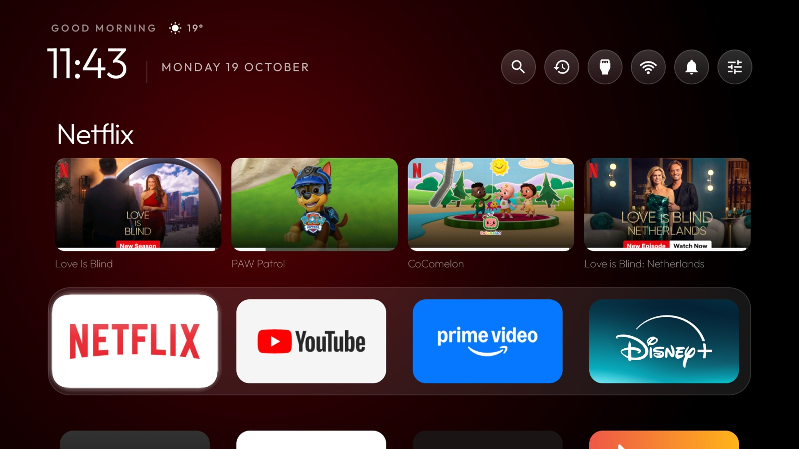
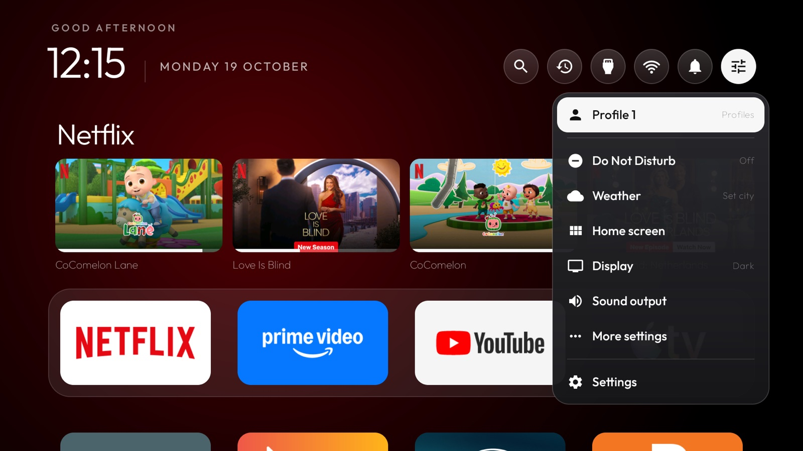
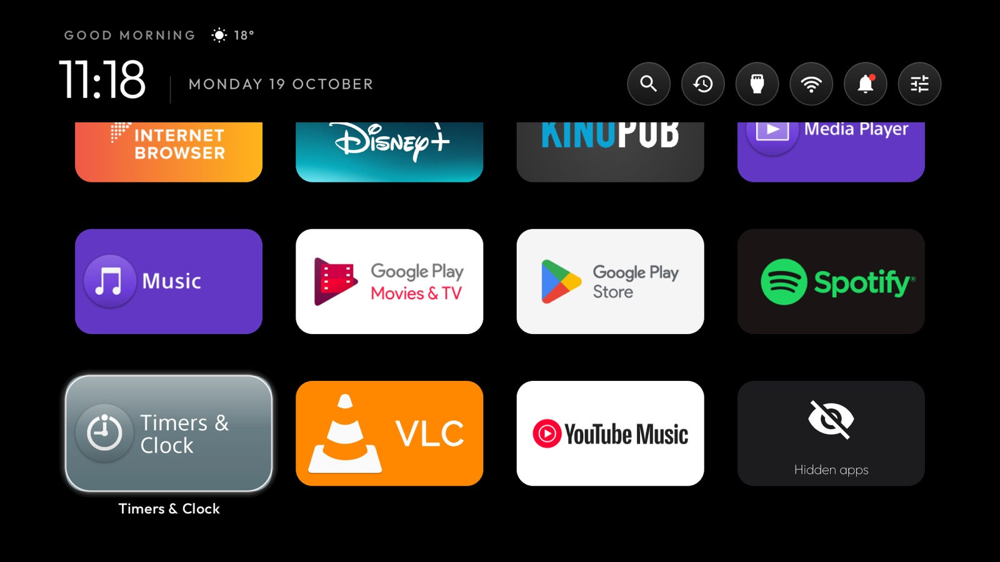
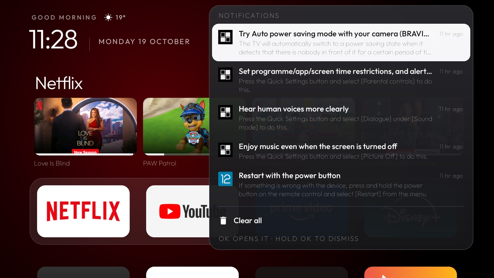
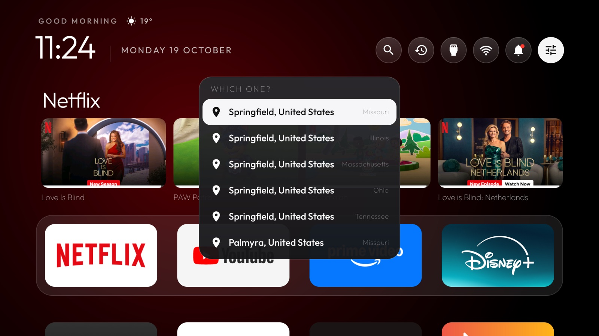

# iTV Launcher

**An Apple TV-style home screen for Android TV and Google TV.**



A native Android TV launcher (`com.krushock.itvlauncher`, about 2 MB) that brings tvOS's home screen
to Android TVs: a dock with a Top Shelf, one floating glass highlight, a Control Center, Now Playing,
folders and profiles. Plain Java and AndroidX, no tracking, no ads, nothing heavier than a
RecyclerView, so it stays quick on 1 GB TVs.

## Contents

- [What you get](#what-you-get)
- [Install](#install)
- [Using it](#using-it)
- [Google TV](#google-tv)
- [Release builds](#release-builds)
- [Going back](#going-back)
- [Privacy](#privacy)
- [Troubleshooting](#troubleshooting)
- [Project layout](#project-layout)
- [Credits and licence](#credits-and-licence)

## What you get

- **A dock and a Top Shelf**, as on Apple TV: your favourite apps in a glass band at the bottom, and
  the focused app's Continue watching (with progress bars) and previews right above it. Rest on a
  card for three seconds and it takes over the screen with the title, time left, **Play** and
  **More Info**; the artwork fills the background behind it.
- **One floating glass highlight** that springs from tile to tile. The focused tile lifts and swings
  in from the direction you came, and pressing against an edge gives a small bump. Every move
  plays the TV's navigation click.
- **Now Playing in the top bar** while music or video plays in the background: cover, title and
  moving bars. OK opens the player (previous, play/pause, next, open the app); holding OK goes
  straight to the app.
- **A Controls panel**, like Control Center: Now Playing, profiles, Do Not Disturb, weather, home
  screen layout, display (Light, Dark or Automatic, Larger text, Reduce Motion), sound output,
  shortcuts into the TV's own settings, and Settings itself.
- **Recent apps**, like the App Switcher: the apps you used last as cards over the home screen.
- **A notifications bell** with a red dot when there's something to read. OK opens one, holding OK
  dismisses it, Clear all empties the list. Google TV keeps these inside its own launcher, so
  without this they'd have nowhere to go.
- **Search, Inputs and an honest Wi-Fi icon**: signal strength, an animation while connecting, "!"
  when the internet isn't reachable, a cable on Ethernet.
- **Arrange it from the remote**: move tiles, add or remove them from the dock, make folders (with
  a suggested name such as Games or Music), hide apps, choose 4, 5 or 6 tiles per row. Each person
  can have a **profile** with their own arrangement.
- **Back up and restore the layout** to Downloads or a USB drive, to carry it to another TV.
- **The weather** next to the greeting, from [Open-Meteo](https://open-meteo.com). When a city name
  matches several places, you pick the right one.
- **Two screensavers**: a large drifting clock, and a slideshow of your own photos.
- **On Google TV, Google's features keep working**: voice search, the Assistant, and the Google Home
  panel (hold Home). See [Google TV](#google-tv).
- English and German.

| | |
|---|---|
|  |  |
|  |  |

## Install

You need an Android TV or Google TV on **Android 8 or newer**, and a computer on the same network.
The computer needs **Python 3**, plus
**JDK 17 or newer** and the **Android SDK** (platform 37). With
[Android Studio](https://developer.android.com/studio) installed, the JDK and SDK are already there.

**1. On the TV: switch on USB debugging.** It also opens debugging over the network; no cable
needed.

- Google TV: Settings → System → About → press OK on **Android TV OS build** seven times, then
  Settings → System → Developer options → **USB debugging**.
- Android TV: Settings → Device Preferences → About → press OK on **Build** seven times, then
  Developer options → **USB debugging**.

Note the TV's IP address (Settings → Network).

**2. On the computer: build and install.**

```bash
python3 -m venv tools/venv && tools/venv/bin/pip install -r tools/requirements.txt
```

```bash
TV_HOST=192.168.1.50 launcher/build-and-install.sh
```

On Windows (PowerShell):

```powershell
python -m venv tools\venv; tools\venv\Scripts\python.exe -m pip install -r tools\requirements.txt
powershell -ExecutionPolicy Bypass -File launcher\build-and-install.ps1 -TvHost 192.168.1.50
```

The first time, the TV asks **"Allow USB debugging?"**: tick *Always allow from this computer* and
choose OK.

The script builds the launcher (a signed release if you've set up a [signing key](#release-builds),
otherwise a debug build), installs it, and grants what each feature needs (listed under
[Privacy](#privacy)). Then it makes the launcher your home screen:

- **On Google TV**, it switches on the launcher's Home button service and leaves Google TV's own
  home on (see [Google TV](#google-tv)).
- **On other Android TVs**, it makes the launcher the default home and switches the stock launcher
  off, but only after the install succeeded, so Home never ends up without a home screen.

If Play Protect asks to scan the app, allow it. The launcher targets the newest Android, so the
"built for an older version of Android" warning doesn't appear.

Without Android Studio, on macOS:

```bash
brew install openjdk android-commandlinetools
```

```bash
sdkmanager "platforms;android-37.0" "build-tools;36.0.0"
```

The starting dock, the apps hidden at first, your TV's Live TV app and the starting number of
tiles per row are set in
[`launcher/app/src/main/res/values/config.xml`](launcher/app/src/main/res/values/config.xml); after
that you arrange everything on the TV.

## Using it

- **Home** always brings you back. Press it on the home screen to close menus and return to the dock.
- **Hold OK on a tile** for its menu: Move, Add to dock / Remove from dock, Move to folder, Hide,
  App info. **Move** picks the tile up: each arrow press carries it one slot, OK places it, Back puts
  it back. Folders are made with **Move to folder → New folder**.
- **Up from the dock** goes into the Top Shelf, and from there to the top bar.
- **The top bar**, left to right: Now Playing (while something plays), Search, Recent, Inputs,
  Wi-Fi, Notifications, Controls.
- **Hidden apps** gather in a tile at the end of the grid; open it to bring one back.
- **Controls → Home screen** has tiles per row, **Back up layout** and **Restore layout**.
- **Controls → Display** has Light, Dark or Automatic (light from 7:00 to 19:00), Larger text and
  Reduce Motion. Reduce Motion also turns on by itself when the TV's animations are switched off.

<details>
<summary><strong>The screensavers</strong></summary>

**Clock**: a large thin clock and the date over an ambient glow; every minute it drifts to a new spot
so nothing burns in. **Photos**: every picture in any folder named **Screensaver**, on a USB drive
or the TV's storage, shuffled with a slow drift. Pick either in the TV's screensaver settings, or
over ADB:

```bash
TV_HOST=192.168.1.50 tools/venv/bin/python -I tools/tv.py 'settings put secure screensaver_components com.krushock.itvlauncher/.ClockDream; settings put secure screensaver_enabled 1'
```

(`.PhotoDream` for the photos.) "Start screensaver" under Controls → More settings shows it straight
away, on TVs that offer that.


</details>

## Google TV

Google TV's own home always takes the Home button while it's switched on. Switching it off isn't an
option either: the Assistant asks it which mode the TV is in, so voice search fails ("Google
Assistant has trouble processing your request"), the Google Home panel disappears, and Google's
setup app then shows a black screen on Home.

So on Google TV, the install script leaves Google's home on and switches on the launcher's
accessibility service, **Home button for this home screen** (`HomeKeyService`):

- **Pressing Home** opens this launcher.
- **Holding Home** opens Google TV's panel, with the Google Home controls, profile and quick settings.
- **When Google TV's home appears anyway** (after a restart, or backing out of an app), the service
  switches straight to this launcher. Occasionally you'll see Google TV's home for a split second.

The service sees only the Home key and the windows of Google TV's home and setup apps; it can't
read anything on screen. You'll find it in Settings → System → Accessibility.

If an earlier install had switched Google TV's home off, the script lets it load once for 20
seconds after switching it back on. Until it has, Google's title pages (the results of a voice
search) keep loading for a minute or more.

## Release builds

The install script builds a signed, non-debuggable release when it finds a signing key, and a debug
build otherwise. Create the key once, **outside the repository**, and keep a copy somewhere safe:
every update must be signed with the same key, or the TV refuses it.

```bash
mkdir -p ~/.config/krushock && keytool -genkeypair -keystore ~/.config/krushock/itvlauncher-release.jks \
  -storetype PKCS12 -alias itvlauncher -keyalg RSA -keysize 4096 -validity 36500
```

Then put its details in `~/.config/krushock/itvlauncher-signing.properties`:

```properties
storeFile=/Users/you/.config/krushock/itvlauncher-release.jks
storePassword=…
keyAlias=itvlauncher
keyPassword=…
```

or point `ITVLAUNCHER_SIGNING` at a file like it. `BUILD_VARIANT=debug` forces a debug build.

Android won't install a build signed with a different key over the one on the TV, so switching
between debug and release means uninstalling first. Carry your arrangement over with **Back up
layout** and **Restore layout**; a backup can also be put into
`/sdcard/Android/data/com.krushock.itvlauncher/files/` over ADB, where the new install finds it.

## Going back

**Without a computer, on Google TV:** Controls → More settings → **Use Google TV home**. The Home
button service switches itself off and Google TV is your home screen again. To come back, switch
**Home button for this home screen** on in Settings → System → Accessibility.

**On other Android TVs**, the same menu item opens the stock launcher's page in Settings: choose
Enable, then OK. Coming back means running the install script again.

**To uninstall**, switch the stock launcher back on first (other Android TVs only; Google TV's never
went off). Its package name varies by TV; `com.google.android.tvlauncher` is the usual one. Then
remove the app:

```bash
TV_HOST=192.168.1.50 tools/venv/bin/python -I tools/tv.py 'pm enable com.google.android.tvlauncher'
```

```bash
TV_HOST=192.168.1.50 tools/venv/bin/python -I tools/tv.py 'pm uninstall com.krushock.itvlauncher'
```

Your arrangement is stored on the TV and goes with the app; back it up first if you'll want it again.

## Privacy

**What it connects to:** Open-Meteo for the weather, which receives only the coordinates of the city
you chose, and the artwork addresses your own apps publish (Top Shelf pictures, album covers). No
account, no analytics, no ads. The weather refreshes at most every 30 minutes, and only while the
home screen is showing. Offline, everything keeps working.

**What the install script grants**, each for one feature, and nothing it reads leaves the TV:

| Permission | For |
|---|---|
| Location | Reading the Wi-Fi network's name (Android only shows it with location access) |
| Photos | The photo screensaver |
| TV listings | The Top Shelf (Continue watching and previews) |
| Usage access | Recent apps |
| Notification access | The notifications bell and Now Playing |
| Do Not Disturb access | The Do Not Disturb switch in Controls |
| Accessibility (Google TV) | The Home button service |
| See all apps | Listing your apps (standard for launchers) |

## Troubleshooting

- **macOS: `adb connect` says "No route to host"** although the TV is reachable. Recent macOS
  blocks the `adb` binary under Local Network privacy. The included `tools/tv.py` is a pure-Python
  ADB client that avoids it.
- **No "wireless debugging" toggle on the TV**: USB debugging alone opens network ADB on port 5555.
- **Windows PowerShell 5.1 adds a byte-order mark** to piped text. `tv.py` strips it, and the `.ps1`
  scripts pipe clean UTF-8.
- **Git Bash rewrites paths** like `/data/local/tmp`. The scripts set `MSYS_NO_PATHCONV=1`; set
  `JAVA_HOME` and `ANDROID_HOME` before building there.
- **"INSTALL_FAILED_UPDATE_INCOMPATIBLE"**: the TV has the launcher signed with another key. See
  [Release builds](#release-builds).
- **No on-screen keyboard** after switching launchers, seen on Xiaomi: the default input method
  points at a keyboard that isn't installed. Fix:
  `tools/tv.py 'ime set com.google.android.inputmethod.latin/com.android.inputmethod.latin.LatinIME'`
- **Screenshots come out black** while Live TV or an HDMI input is on screen. Press Home first.
- **Android emulator**: its window keeps the Esc key to itself, so use ⌘⌫ (Back) instead. If arrows
  stop moving between some items, the emulator thinks Shift and Alt are held down; restarting it
  clears that.

## Project layout

```
launcher/                     the Android app (Gradle project)
  app/src/main/java/com/krushock/itvlauncher/
    MainActivity.java         the home screen: dock, grid, top bar, menus, move mode
    AppAdapter.java           tiles, folders, the hidden-apps tile
    HomeLayout.java           profiles and each profile's arrangement
    TopShelf.java             Continue watching and previews, the full-screen shelf
    NowPlaying.java           the playing media session and its artwork
    HomeKeyService.java       Google TV: the Home button service
    MediaWatcher.java         notification listener (bell, Now Playing)
    GlassPopup.java           menus and popups
    Weather.java              Open-Meteo weather and the city search
    LayoutBackup.java         back up and restore the arrangement
    ClockDream.java           the clock screensaver
    PhotoDream.java           the photo screensaver
  build-and-install.sh/.ps1   build, install, grant, make it home
tools/
  tv.py                       pure-Python ADB client: shell, batch, push, pull
  b64push.py                  uploads APKs in checked chunks
docs/                         screenshots
```

`tools/tv.py` works on its own too:

```bash
TV_HOST=192.168.1.50 tools/venv/bin/python -I tools/tv.py --probe
```

That shows the model, Android version and firmware; pass any shell command instead of `--probe` to
run it on the TV.

## Credits and licence

Started from [tv-vibehack](https://github.com/Gathin23/tv-vibehack) by Gathin. MIT, see
[`LICENSE`](LICENSE). The Outfit typeface is under the SIL Open Font License, see
[`launcher/FONT-LICENSE-OFL.txt`](launcher/FONT-LICENSE-OFL.txt). Weather data by
[Open-Meteo](https://open-meteo.com).
